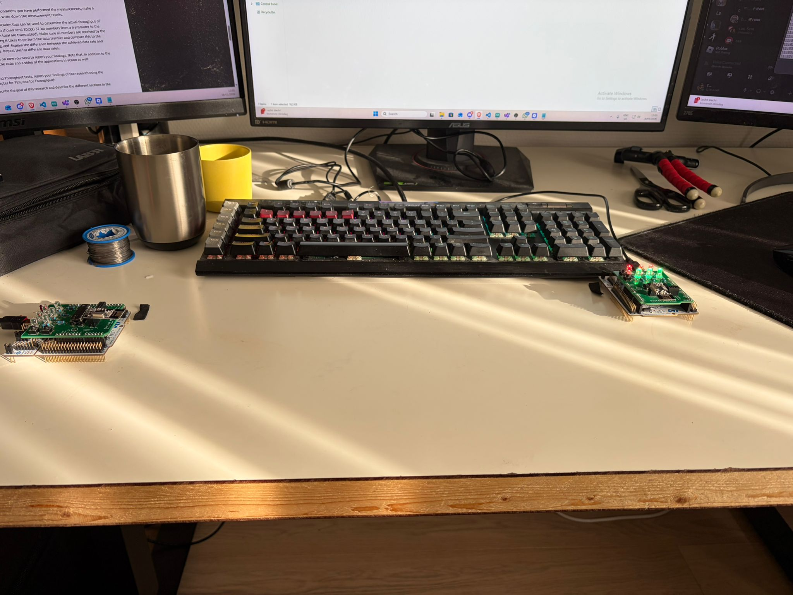
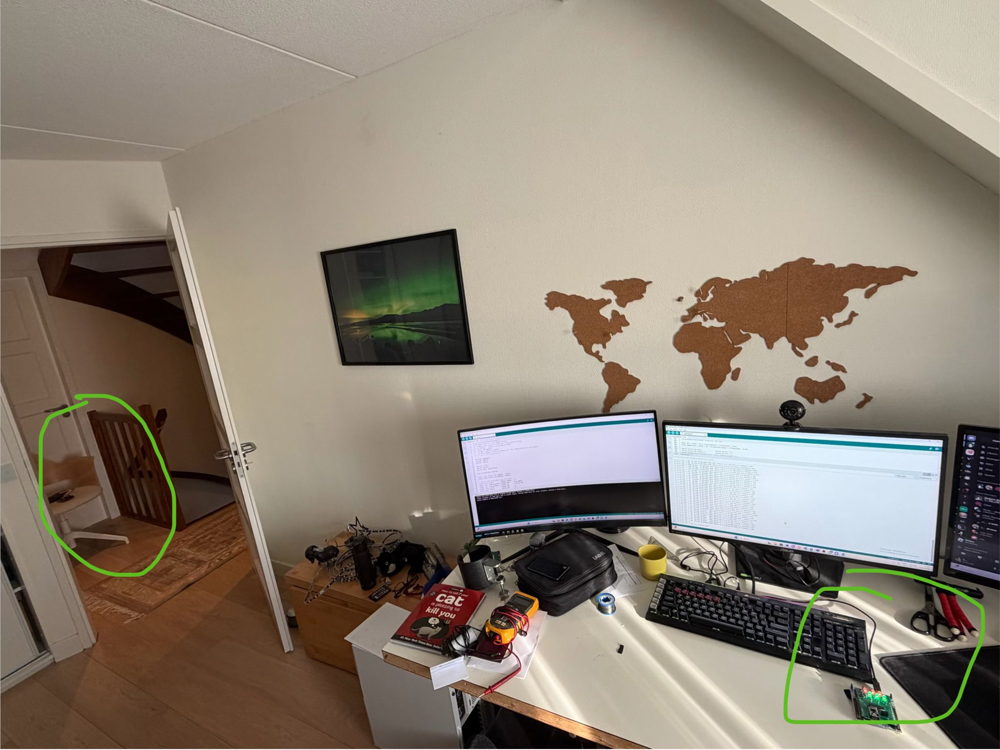
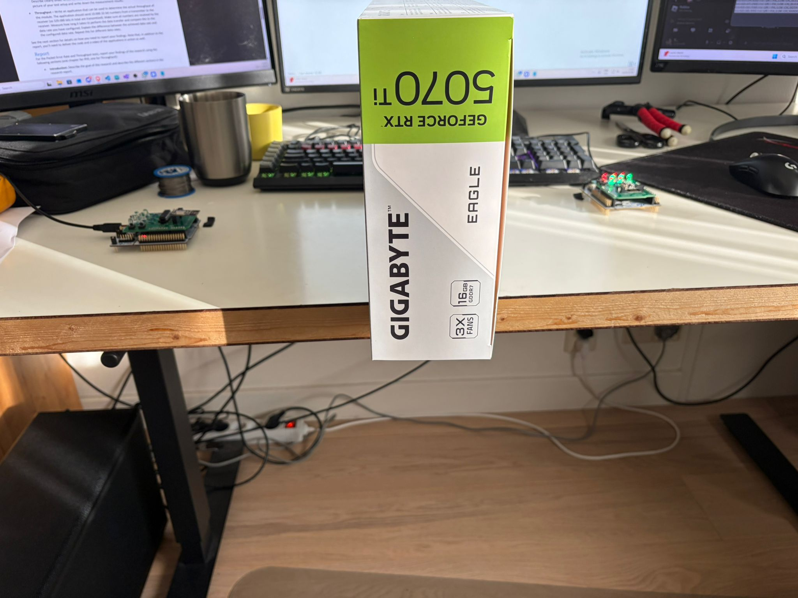

# Exploring radio links with STM32

What happens when two boards try to keep a row of LEDs in sync over the air? And how much of a radio's advertised speed reaches an application? We used two STM32 Nucleo boards and nRF24L01+ radios to find out, starting with a small interactive build and then putting the link through a few tests.

## Start with the LEDs

The [LED sync sketch](LedSync/LedSync.ino) runs on both boards. Press a button on either one to increase or decrease the number of lit LEDs; the other board mirrors the change over the radio. Each update carries the whole LED count, so a later successful message can bring the boards back into sync after a missed one. The sketch uses acknowledgements and retries, and ignores repeated or older updates.

## Then test the link

For the packet-loss experiment, one board sends test packets while the other receives them. The [transmitter](RadioTests/PacketErrorRateTx/PacketErrorRateTx.ino) steps through presets for channel, radio speed, transmit power, and retries; the [receiver](RadioTests/PacketErrorRateRx/PacketErrorRateRx.ino) follows along. We tried three physical setups:

### Close together

On a relatively clear channel, most settings delivered packets reliably. At 2 Mbps with low transmit power, we saw no packet loss or retries. At 1 Mbps, allowing a few retries improved on the weakest retry setting. Surprisingly, high transmit power often performed *worse* at this short distance, with more retries and packet loss; more power wasn't automatically better in our setup.

### About five metres apart

The greater distance made weak settings more noticeable. A small retry budget was less dependable at 1 Mbps, while a few retries generally helped on clear channels. Busy channels still led to more retries and sometimes lost packets.

### With a box in the way

The box had less impact than moving the radios five metres apart. Clear channels stayed fairly reliable, but interference-prone channels and high transmit power remained troublesome.

**The takeaway:** In these surroundings, picking a clear channel and allowing some retries mattered more than simply turning up the transmit power. These are observations from our setups, not a universal best configuration.

## How fast did the data arrive?

Next, we sent **10,000 numbers** (40,000 bytes of application data) at each of three radio speeds. The [throughput transmitter](RadioTests/ThroughputTx/ThroughputTx.ino) reports the time and achieved speed; the [receiver](RadioTests/ThroughputRx/ThroughputRx.ino) checks the sequence as it arrives.

| Radio setting | Transfer time | Measured throughput |
| --- | ---: | ---: |
| 250 kbps | 102.616 s | 3.12 kbps |
| 1 Mbps | 138.257 s | 2.31 kbps |
| 2 Mbps | 5.742 s | 55.73 kbps |

The on-air speed is clearly not the same as the speed of the full transfer. In these runs, 2 Mbps was by far the fastest, while 1 Mbps even finished behind 250 kbps. Retries, acknowledgements, and time spent waiting can affect the result; the measurements alone don't tell us which factor caused that particular reversal.

## Explore the sketches

| Folder | What's inside |
| --- | --- |
| [`LedSync/`](LedSync/) | The two-board LED and button demo. Use the same sketch on each board with a different `DEVICE_ADDR` (0 and 1). |
| [`RadioTests/PacketErrorRateTx/`](RadioTests/PacketErrorRateTx/) | Packet-loss transmitter and its test presets in `RF24TestConfigs/`. |
| [`RadioTests/PacketErrorRateRx/`](RadioTests/PacketErrorRateRx/) | Packet-loss receiver. |
| [`RadioTests/ThroughputTx/`](RadioTests/ThroughputTx/) | Throughput transmitter; prints the measured transfer speed. |
| [`RadioTests/ThroughputRx/`](RadioTests/ThroughputRx/) | Throughput receiver; checks incoming values. |

The sketches target STM32 Nucleo boards with nRF24L01+ modules (and an MCP23S08 for the LEDs and buttons). Each sketch has a `sketch.yaml` for the Nucleo F303RE. For the packet-loss test, start the receiver before the transmitter and watch the transmitter's serial output for results. For the throughput test, set `RF_RATE` to the **same value on both boards** before each run; use a 115200-baud serial monitor to see the results. The measured speeds above come from our runs, so your surroundings may give different numbers.

---

By **Dan Zavadin** and **Thijs Besseling**.
